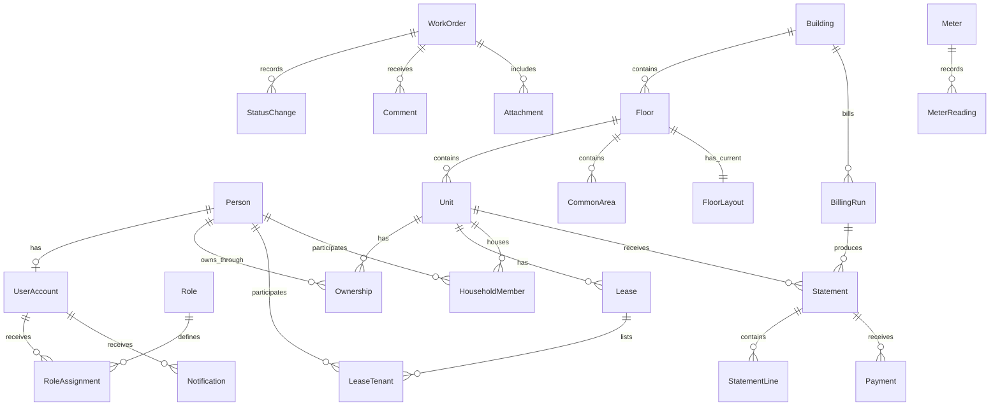

# ADR-00N: Database Engine and Data Model

- **Status:** Proposed
- **Date:** 2026-11-24
- **Author(s):** TBD
- **Requirement IDs:** DB-C01, DB-C02, DB-C03, DB-C04, DB-C07, DB-A01, DB-A02, DB-A06, M3-04, M5-02, M5-06, M5-07, M5-09, ARC-07
- **Supersedes:** None
- **Superseded by:** None

## Context

The DevAcademy 2026-2027 Capstone Requirements require a data model covering Identity and Access (M1), Buildings (M2), Occupancy and Leases (M3), Maintenance (M4), Utilities and Billing (M5), Communication (M6), and Audit (M7).

The domain has strongly related records, concurrent updates, date-effective leases and tariffs, and financial calculations that must reconcile exactly. Important rules include no overlapping active leases for a unit, one meter reading per period, immutable issued financial content, and idempotent payments that cannot exceed the outstanding balance.

The four-person team must deliver all Core and Advanced packages. This makes historical data, reporting and retention relevant to the model. Hosting Preview and Release is also required, but the choice of hosting service belongs in the separate Hosting ADR. Team experience with PostgreSQL remains a consideration for human review; it is not assumed.

This document proposes an engine and logical modeling approach for the Building Operations Platform. It does not decide the hosting provider, local container runtime, backend data-access stack or API authorization policy. It is not a completed physical schema or full column-level data dictionary.

## Decision drivers

- Enforce integrity under concurrent requests, not only through UI validation.
- Support joins, exact decimal calculations, effective-date queries and audit history.
- Meet the Core and Advanced database requirements using allowed technologies.
- Keep the engine choice independent of hosting and local execution tools.
- Version and review the data model and database changes in GitHub.
- Minimize personal data collection and preserve financial and audit integrity.

## Options considered

### Option 1 - PostgreSQL with a relational model (proposed)

- Advantages: Foreign keys, joins, exact numeric arithmetic and transactions fit this domain. Range types and exclusion constraints support the no-overlapping-active-leases rule directly. JSONB can accommodate floor geometry without turning the operational model into a document database.
- Disadvantages: The required temporal history needs explicit history tables and triggers rather than SQL Server-style system-versioned tables. The team must be comfortable maintaining PostgreSQL-specific SQL.
- Risks: Incorrect range boundaries or concurrency handling could weaken business invariants. Extension availability and engine/provider compatibility must be coordinated with the hosting and backend decisions.

### Option 2 - SQL Server with a relational model

- Advantages: Strong relational integrity, exact numeric types, .NET integration and built-in system-versioned temporal tables that directly address DB-A01.
- Disadvantages: Lease-overlap protection requires a concurrency-safe design rather than PostgreSQL-style exclusion constraints. The team would use SQL Server-specific SQL and operational tooling instead.
- Risks: Unsafe transaction design could allow overlapping leases or payment races. Service/edition suitability and costs require separate hosting evaluation; Azure SQL is a hosting/service option, not the reason to choose the relational model.

### Option 3 - A document database, such as MongoDB Community Server, DocumentDB or Azure Cosmos DB

- Advantages: Flexible documents and aggregate-oriented access patterns; permitted options under the PDF's technology rules.
- Disadvantages: Cross-entity relationships, exact billing and occupancy invariants need more explicit modeling without conventional relational foreign keys and joins.
- Risks: Transaction boundaries, partitioning and consistency differ by engine and deployment. They cannot be treated as interchangeable; the extra complexity needs a clear domain benefit that this proposal has not identified.

## Decision

**Propose PostgreSQL as the database engine and a relational data model covering M1-M7.** This remains Proposed pending human review; no team approval is implied.

PostgreSQL fits the relational domain and provides a direct mechanism for enforcing lease overlap. SQL Server remains a valid alternative, particularly if team experience or the cost of implementing temporal history favors it. PostgreSQL is not proposed because of Azure or Podman: neither is the database engine choice.

### Related decisions and boundaries

| Topic | Boundary and coordination |
| --- | --- |
| Preview and Release hosting | Didier can evaluate Azure Database for PostgreSQL Flexible Server and other permitted hosting options in the **Hosting ADR**, including cost, availability, network access, backups and supported extensions. This ADR does not select Azure hosting. |
| Local development setup | Reference the separate **local setup decision** for how developers run PostgreSQL. Podman would run a PostgreSQL container on a laptop; it is a container tool, not the database engine or a shared always-on host. This ADR does not approve the runtime or container configuration. |
| Backend data access and table changes | Agree **EF Core and Npgsql** with Petar. They are candidates, not an accepted decision here. Backend and database work need one shared migration process with clear ownership, ordering and deployment responsibility, not competing tools applying independent table changes. |
| Authorization | The **Authorization ADR** defines how the API combines roles, scope and the resident-unit relationships below to allow a specific action. This ADR defines those relationships, not the access policy. |

The Hosting ADR and local/backend decisions must coordinate a compatible PostgreSQL major version, required extensions and provider versions. This ADR does not fix those versions or assign numbers to the related ADRs.

### What GitHub stores

GitHub is the source of truth for the database **definition and change history**, not a continuously running database server.

Commit the ADR, ERD, data dictionary, migrations and synthetic seed generator. Configuration and infrastructure definitions established by the related decisions also belong in version control. Never commit credentials, connection strings containing passwords, database volumes, real resident data, or sensitive database dumps.

GitHub is not the always-on Preview or Release database host. Secret management and runtime deployment belong to the relevant hosting and setup decisions; commit only secret-free configuration examples.

Versioned migrations keep schema changes reviewable and repeatable. Agree their application process with Petar rather than choosing an EF Core/Npgsql workflow unilaterally. Sharing migration files does not synchronize records between developers' databases. Use reproducible synthetic seed data rather than copying real resident data.

### Modeling approach

Use a relational model normalized to **third normal form where appropriate**. Represent relationships with primary keys, foreign keys and junction tables rather than embedding operational records in documents. Organize tables into logical module schemas or equivalent explicit module boundaries in one database; cross-module foreign keys are permitted and reviewed.

Use UUID primary keys for ordinary domain records, with stable unique constraints for business identifiers. Association tables may use composite keys. Use `date` for business dates and `timestamptz` for instants; define billing-period and building-time-zone behavior explicitly. Use exact `numeric` types for money, tariffs, readings and allocation calculations, with precision and scale documented per column. Do not use floating-point types for billing.

The following inventory extends the conceptual entities on pages 24-25 with proposed relationship tables. These additions are design proposals, not a verbatim schema from the PDF.

| Module | Proposed entities | Main relationships and rules |
| --- | --- | --- |
| M1 Identity and access | Person, UserAccount, Role, RoleAssignment | A Person has zero or one UserAccount; each account belongs to one Person. RoleAssignment records an account's role and building/unit scope; it does not establish that the person owns or occupies a unit. The resident-unit relationship comes from Ownership, from Lease and LeaseTenant together, or from HouseholdMember. The Authorization ADR defines how the API uses that relationship and role scope to permit a specific action. Administrator scope and scoped roles need an explicit constraint design. Credential storage follows the chosen authentication provider, not a custom password mechanism. |
| M2 Buildings | Building, Floor, Unit, CommonArea, FloorLayout | Building has many Floors; Floor has many Units and CommonAreas and one current FloorLayout. Unit identifiers are unique within their agreed building scope. |
| M3 Occupancy and leases | Ownership, Lease, LeaseTenant, HouseholdMember | Ownership links Person and Unit over a dated period. Lease belongs to one Unit; LeaseTenant links one or more Persons to a Lease. HouseholdMember links Person and Unit over time. A renewal references its previous Lease. |
| M4 Maintenance | WorkOrder, StatusChange, Comment, Attachment, SlaPolicy | WorkOrder targets exactly one Unit or CommonArea, has one reporter and at most one assigned technician. It has many StatusChanges, Comments and Attachments. Comments retain their resident-visible/internal distinction. |
| M5 Utilities and billing | Meter, MeterReading, Tariff, CommonExpense, BillingRun, Statement, StatementLine, Payment | Meter targets exactly one Unit or Building and has readings. Tariff applies to a building/utility over an effective period. BillingRun produces Statements per Unit; Statements have lines and payments. CommonExpense belongs to a building/period and has an allocation rule. |
| M6 Communication | Announcement, AnnouncementBuilding, AnnouncementFloor, AnnouncementRole, Notification | Audience association tables reference the applicable buildings, floors and roles. Notification belongs to one UserAccount. Define audience-combination semantics from the functional requirements before implementation. |
| M7 Audit | AuditRecord; LeaseHistory, TariffHistory, StatementHistory | AuditRecord records actor, entity type/ID, action, timestamp and correlation ID. Trigger-maintained history supports historical versions of Lease, Tariff and Statement. History and audit serve different purposes and are not interchangeable. |

Supporting identity-provider tables, upload metadata, job-deduplication records, and any required adjustment/credit-note representation will be added to the physical model with requirement traceability. The inventory above does not by itself establish complete requirement coverage.

### Core relationship sketch

This is a selected relationship sketch, not the complete M1-M7 ERD. Crow's-foot cardinalities express the intended logical relationships; state-dependent requirements, such as a lease needing at least one tenant before activation, require additional validation.

Exclusive-or relationships for WorkOrder locations and Meter scopes are described in the entity inventory rather than shown as unrestricted relationships in this sketch.

### Integrity and concurrency

- Use foreign keys, `NOT NULL`, unique constraints and checks for row-local invariants. Index referencing keys according to actual access patterns; PostgreSQL does not automatically create every useful foreign-key index.
- Enforce M3-04 with a PostgreSQL exclusion constraint on Unit and lease date range, conditional on Active status. Evaluate the `btree_gist` extension for UUID equality in the GiST constraint and verify availability in every environment. The constraint must run when a lease is activated or its dates change, and concurrent conflicting activations must not both succeed.
- Confirm whether the lease end date is inclusive before defining the range. If inclusive, convert it consistently to an exclusive upper bound for half-open range comparisons. Define termination-date handling consistently.
- Require a unique `(meter_id, billing_period)` for readings. Serialize or otherwise concurrency-protect validations involving previous readings and corrections; a uniqueness constraint alone does not establish monotonic readings.
- Enforce exclusive Unit/CommonArea WorkOrder targets and exclusive Unit/Building Meter targets. Validate that all referenced locations and building-scoped records agree; independent foreign keys alone do not prove this.
- Give BillingRun a unique building/period identity and Statement a unique run/unit identity. Preview regeneration must replace draft results transactionally without touching issued financial content. Pin the applicable tariffs and allocation inputs used for issuance.
- Store issued line descriptions, quantities, applied rates and amounts as historical financial snapshots. Issued financial content is immutable; payment/overdue/cancellation state may follow M5-08 without rewriting issued charges. Corrections use reasoned adjustments or credit notes.
- Apply each Payment in a transaction that locks the target Statement before reading the outstanding balance. Require a unique, documented idempotency key/reference scope, reject overpayments, and return a consistent result for retries. Concurrent payments must not both consume the same outstanding balance.
- Validate work-order transitions and actor eligibility transactionally; update current state and append history atomically. Use an explicit concurrency version on contested mutable records where appropriate.
- Use constraints and transactional coordination for multi-row invariants. Detailed isolation levels, lock strategies and retry behavior belong in implementation design rather than being fixed by the engine selection alone.

### Deliberate exceptions to normalization

1. **Floor geometry:** permit a versioned JSONB payload in FloorLayout for coordinates and shapes. Keep identity, occupancy, maintenance and billing data relational. Validate payload shape and referenced Unit/CommonArea IDs, including floor membership; JSONB is not a substitute for foreign keys. Live status is not duplicated into geometry.
2. **Financial snapshots:** duplicate applied tariff/rate and allocation facts into issued financial records intentionally, so later tariff changes do not change past statements. Use deterministic rounding and leftover-cent allocation consistent with M5-07, including a documented tie-breaker.
3. **Reporting summaries:** use materialized views or job-refreshed summary tables for DB-A02. Document refresh cadence and staleness; these are derived data, not the authoritative source for payment acceptance or other integrity decisions.
4. **Generic audit references:** AuditRecord's entity type/ID references multiple possible tables and therefore cannot be one conventional foreign key. Validate targets when writing audit records and retain useful historical references under the approved retention policy. Do not copy unnecessary personal data into audit payloads.

### History, privacy and security

Maintain Lease, Tariff and Statement history with database triggers, validity intervals and deterministic as-of queries. Separate business-effective dates from the time a database version was recorded. Define trigger capture, interval boundaries and behavior under repeated updates in one transaction during implementation.

Use a least-privilege application identity that is not an owner or administrator and a separate migration identity. Coordinate connectivity, TLS and credentials with the Hosting ADR and shared migration process. Keep personal data out of ordinary logs. Database keys establish relationships; the Authorization ADR specifies how the backend enforces access to them.

Define an anonymization procedure for former residents that preserves financial and audit integrity, including PII-bearing history and attachment metadata. Agree retention periods before implementing deletion jobs. Keep only the personal fields justified by the requirements. Development and CI use synthetic data only.

## Consequences

- Positive: A relational model makes the domain's relationships explicit; PostgreSQL supports exact numeric calculations, transactional workflows and direct lease-overlap constraints. Hosting and local execution remain separate choices. The clarified resident-unit links support a consistent discussion with the Authorization ADR.
- Negative: The team must maintain PostgreSQL-specific SQL and explicit temporal history. The model still needs a complete ERD and column-level dictionary. A shared migration process must be coordinated with the backend rather than assumed from the engine choice.
- Follow-up actions: Review the PostgreSQL proposal as a team; have Didier evaluate hosting in the Hosting ADR; reference the separate local setup decision; agree EF Core/Npgsql and one table-change process with Petar; complete the physical model, date boundaries, numeric precision, indexes and retention rules; assign the ADR number and authors using the repository convention. Implementation testing is tracked separately, not listed here or required before accepting this ADR.

## Evidence and verification

The proposal is based on the supplied DevAcademy Capstone Requirements v1.4 Markdown and the clearer page 24 conceptual diagram. The requirements are primary decision inputs; they do not establish measured engine performance or operational suitability for a chosen host.

| Source | Relevance |
| --- | --- |
| Page 7 and page 40, section 7.4 | PostgreSQL is a permitted engine; technology and licensing constraints apply. |
| Page 18, M3-02-M3-05 | Ownership, leases and household records establish occupancy; active leases must not overlap. |
| Pages 20-21, M5 | Exact billing, unique readings, immutable issued financial content and idempotent payments drive consistency needs. |
| Pages 24-25 | Conceptual entities and relationships across M1-M7; explicitly a starting point, not a schema. |
| Pages 26-27, section 5.2 | A four-person team delivers Core and Advanced packages; hosting is coordinated separately. |
| Pages 33-35, section 6.3 | Engine comparison, model normalization, integrity and the Advanced history/reporting requirements. |

No experiment, benchmark, prototype or deployment measurement is claimed as supporting evidence. The proposal and its relationship mapping remain subject to human review. Database tests are implementation work, not an ADR acceptance condition.

## AI assistance

GitHub Copilot drafted the options comparison, relational modeling proposal and relationship sketch, then revised the document using the supplied template and review feedback. The revision separates hosting, local setup, backend integration and authorization from the engine/model proposal, and clarifies the existing resident-unit relationships without changing the table inventory or diagram.

The supplied human feedback informed this revision; a completed independent technical verification of the full ADR has not been recorded. Team review of the requirements mapping and proposed decision remains pending. No approval or completed implementation verification is implied.
