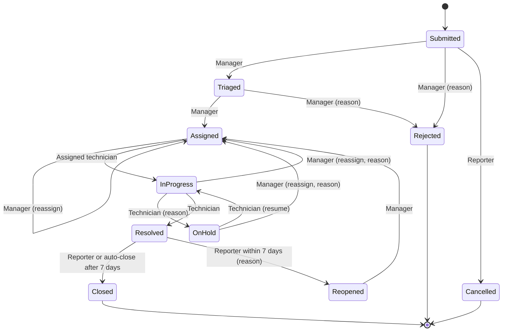

# Product requirements M1–M4

All requirements in this file have scope **CORE** (every team builds them). "Manage" means: create, read, update, deactivate or archive — with validation, authorization and an audit record. Table schema: `ID | Level | Scope | Requirement | Evidence`. Per-module acceptance criteria are listed after each table (the jury checks them); the Evidence column is therefore `—` for product rows.

**Suggested order:** M1 → M2 → M3 → M4 → M5, with M6 and M7 growing alongside from the start. Build a thin slice of each module first, then deepen.

## Thin first slices

| Module | Thin first slice | Then add |
|---|---|---|
| M1 Identity | Sign-in with seeded accounts for the four roles; one protected endpoint per role. | Invitations, scoped role assignments, deactivation, object-level checks on every endpoint. |
| M2 Buildings and map | One building and one floor drawn from a JSON layout; clicking a unit opens its page. | Statuses with legend and filters, the list view, keyboard support, a second building. |
| M3 Leases | Persons, ownership and one active lease per unit. | Full lifecycle, renewals, concurrency-safe overlap check, occupancy history. |
| M4 Work orders | Submit → triage → assign → resolve: the happy path of Scenario A. | Every transition and role check, the SLA, internal notes, the jobs, the board. |

## M1 — Identity, roles and access

| ID | Level | Scope | Requirement | Evidence |
|---|---|---|---|---|
| M1-01 | MUST | CORE | Users sign in and sign out; sessions expire (see SEC-02). | — |
| M1-02 | MUST | CORE | Support four roles: Administrator, Building Manager, Resident (Tenant or Owner), Technician. Role assignments are scoped: managers to buildings; technicians to buildings (and categories, if modelled); residents to units through ownership, lease or household membership. | — |
| M1-03 | MUST | CORE | Keep the person (identity and contact data), the user account and the role assignments separate. A person may hold several roles; a person may exist without an account (for example a household member). | — |
| M1-04 | MUST | CORE | No public self-registration. Administrators invite or create users of any role; Building Managers invite residents of their buildings. Administrators assign and revoke roles and deactivate accounts. Accounts are never hard-deleted; their history remains. | — |
| M1-05 | MUST | CORE | Enforce object-level authorization on every API operation: access depends on the role and the relationship to the resource (for example a resident can read a lease only if they are a party to it). | — |
| M1-06 | MUST | CORE | The interface adapts to the role (navigation, actions), but the API is always the enforcement point. | — |
| M1-07 | SHOULD | CORE | Profile page with contact details, notification preferences and password change (or a link to the identity provider). | — |
| M1-08 | MAY | CORE | Multi-factor authentication or passkeys. | — |

**M1 acceptance criteria**
- A resident who changes an identifier in a URL or API call cannot read or change another resident's unit, lease, statement or work order — proven by automated tests.
- A manager cannot access buildings they are not assigned to — proven by automated tests.
- A deactivated user cannot sign in, and their past actions remain visible in the audit trail.

## M2 — Buildings, floors, units and the interactive 2D floor map

| ID | Level | Scope | Requirement | Evidence |
|---|---|---|---|---|
| M2-01 | MUST | CORE | Manage buildings (name, address, contact, status), floors (level, label), units (number, type — apartment, commercial, storage or parking — area in m², rooms, floor) and common areas (stairwell, basement, elevator, roof and similar). | — |
| M2-02 | MUST | CORE | A unit's status combines occupancy (Occupied or Vacant, derived from the M3 occupancy records) and an operational state: Open issue (unit has an active work order, see M4), Under maintenance (a work order for the unit is In Progress), Unavailable (set by a manager, with a reason) or Normal. Derived states are calculated, never set by hand. When several apply the map shows the most severe: Unavailable, then Under maintenance, then Open issue. | — |
| M2-03 | MUST | CORE | Each floor has a layout stored as data (for example rectangles or polygons with coordinates for each unit and common area, in JSON or relational form). Seed at least two buildings with different layouts. A layout editor MAY be provided; importing layouts from JSON is acceptable. | — |
| M2-04 | MUST | CORE | Interactive 2D floor map rendered from layout and live status data (SVG or Canvas): choose building and floor; units drawn from the layout; status shown with colour AND a pattern, icon or label (never colour alone); a legend; filter or highlight by status; tooltip on hover and focus; click or Enter opens the unit detail page. | — |
| M2-05 | MUST | CORE | Map accessibility: every unit is reachable by keyboard and has an accessible name (example: "Unit 4B, occupied, 1 open issue"). Provide an equivalent list or table view with the same data and filters. | — |
| M2-06 | MUST | CORE | Role-aware map data: residents see their building without other residents' personal data; managers see full detail for their buildings; technicians see units with assigned work highlighted. | — |
| M2-07 | MUST | CORE | Unit detail page: attributes, occupancy and current lease (if authorized), open and past work orders, meters and recent readings, recent statements (if authorized), and history. | — |
| M2-08 | SHOULD | CORE | The map reflects changes without a full page reload: refetch on focus or on an interval in Core; real-time push is FE-A03 and BE-A04. | — |
| M2-09 | MAY | CORE | Zoom and pan, minimap, print view. | — |

**M2 acceptance criteria**
- Changing a unit's layout or status data changes the map. Nothing is hard-coded or drawn as a static image.
- Every map function can be used with the keyboard alone, and the automated accessibility check on the map page reports no critical violations.
- The 2D floor map is mandatory. A 3D view (X3) is optional and can never replace it.

**Example map legend (illustration, not a requirement):** Occupied = blue + person icon; Vacant = grey + diagonal hatch; Open issue = amber + "!" icon; Under maintenance = violet stripes + wrench; Common area = stairwell/elevator shapes; keyboard focus = visible focus ring.

**Example floor layout data (one possible format, illustration):**
```json
{
  "buildingId": "aurora",
  "floor": 4,
  "width": 1000,
  "height": 520,
  "shapes": [
    { "kind": "common", "areaId": "stair-4", "label": "Stairwell", "points": [[0,20],[70,20],[70,220],[0,220]] },
    { "kind": "unit", "unitId": "4A", "label": "4A", "points": [[80,20],[270,20],[270,220],[80,220]] },
    { "kind": "unit", "unitId": "4B", "label": "4B", "points": [[280,20],[470,20],[470,220],[280,220]] }
  ]
}
```
The map combines this geometry with live status data from the API, so a status change never requires a layout change.

## M3 — Residents, occupancy and leases

| ID | Level | Scope | Requirement | Evidence |
|---|---|---|---|---|
| M3-01 | MUST | CORE | Manage persons (owners, tenants, household members) with minimal personal data. Document why each personal field is needed (data minimization, SEC-13). | — |
| M3-02 | MUST | CORE | Ownership records link units to one or more owners with start and end dates (an ownership share MAY be recorded). | — |
| M3-03 | MUST | CORE | Lease lifecycle: Draft → Active (a manager activates; activation checks M3-04) → Ended (scheduled job after the end date, M3-06); Draft → Cancelled; Active → Terminated (early, with a reason and an effective date). A lease records unit, tenant(s), start and end dates, monthly rent and currency, deposit and notes. A renewal creates a new Draft lease linked to the previous one. | — |
| M3-04 | MUST | CORE | No overlapping active leases for the same unit. Enforce in the database or in a transaction that is safe under concurrent requests, and prove it with a test. | — |
| M3-05 | MUST | CORE | Occupancy history per unit — who lived there, when, in what capacity — derived from ownership, lease and household records. | — |
| M3-06 | MUST | CORE | A scheduled job flags leases ending within 30 days (notifying the manager and the tenant once per lease) and moves leases past their end date to Ended. | — |
| M3-07 | MUST | CORE | Managers manage leases in their buildings; residents read their own leases; technicians have no access to leases. | — |
| M3-08 | SHOULD | CORE | Attach a signed lease document (PDF) following the safe-upload rules in SEC-07. | — |

**M3 acceptance criteria**
- Activating a lease that overlaps another active lease on the same unit fails with a clear validation error — including when two requests race (integration test).
- The platform can answer "Who lived in unit 4B on 1 March?" from the occupancy history.

## M4 — Maintenance requests and work orders (flagship workflow)

| ID | Level | Scope | Requirement | Evidence |
|---|---|---|---|---|
| M4-01 | MUST | CORE | Residents (and managers on their behalf) submit requests with location (unit or common area), category (Plumbing, Electrical, Heating, Elevator, Cleaning, Other), priority (Low, Normal, High, Emergency), description and up to **three photos** (validated type and size, for example JPEG, PNG or WebP, up to 5 MB each). | — |
| M4-02 | MUST | CORE | Implement the work-order state machine in the transition table and diagram below. | — |
| M4-03 | MUST | CORE | The API rejects invalid transitions with a domain error (ProblemDetails, HTTP 409 or 422). Every allowed and forbidden transition is tested for each role. | — |
| M4-04 | MUST | CORE | A configurable SLA policy (Administrator) sets the target resolution time per priority — for example Emergency 4 hours, High 24 hours, Normal 3 days, Low 7 days. The due date is calculated at submission (submission time + target) and recalculated if the manager changes the priority during triage. Work orders show **due soon** (less than 25% of the target time left) and **overdue** indicators. | — |
| M4-05 | MUST | CORE | Work can be assigned only to technicians eligible for the building (and category, if modelled). Reassignment keeps the history. | — |
| M4-06 | MUST | CORE | Two comment channels: resident-visible comments and internal work notes (managers and technicians only), separated by the API — not just hidden in the interface. | — |
| M4-07 | MUST | CORE | A complete status history (who, when, from → to, reason) and audit records. | — |
| M4-08 | MUST | CORE | A technician work queue with filters (status, priority, due date) and a work-order detail view with quick status actions. | — |
| M4-09 | MUST | CORE | Notifications to the reporter on every status change (internal notes are never included), and to managers on new High or Emergency requests and on SLA breaches. | — |
| M4-10 | MUST | CORE | An SLA escalation job flags overdue work orders and notifies the manager exactly once per breach (idempotent). | — |
| M4-11 | MUST | CORE | An auto-close job closes Resolved work orders after 7 days without a reopen. | — |
| M4-12 | SHOULD | CORE | A Kanban board for managers and technicians with drag-and-drop status changes and a keyboard-accessible alternative. | — |
| M4-13 | SHOULD | CORE | The reporter confirms the resolution and MAY rate the service from 1 to 5. | — |
| M4-14 | MAY | CORE | Record labour time and parts used. | — |

### Work-order transitions (M4-02)

| From | To | Who |
|---|---|---|
| Submitted | Triaged | Manager |
| Submitted | Rejected (reason required) | Manager |
| Submitted | Cancelled | Reporter |
| Triaged | Assigned | Manager |
| Triaged | Rejected (reason required) | Manager |
| Assigned | Assigned (reassignment) | Manager |
| In Progress or On Hold | Assigned (reassignment, reason required) | Manager |
| Assigned | In Progress | Assigned technician |
| In Progress | On Hold (reason required) | Assigned technician |
| On Hold | In Progress | Assigned technician |
| In Progress | Resolved | Assigned technician |
| Resolved | Closed | Reporter, or the auto-close job after 7 days |
| Resolved | Reopened (reason required) | Reporter, within 7 days |
| Reopened | Assigned | Manager |

- **Active** work orders: Submitted, Triaged, Assigned, In Progress, On Hold, Reopened.
- **Not active:** Resolved, Closed, Rejected, Cancelled.
- Terminal states: Closed, Rejected, Cancelled. Initial state: Submitted.



**M4 acceptance criteria**
- Scenario A runs end-to-end on the Release environment.
- Allowed and forbidden transitions are covered by table-driven automated tests for every role.
- No resident-facing endpoint ever returns an internal work note (automated test).

## Related requirements to read with this file
- Authorization rules: SEC-03 (11). Permission matrix: 04 §4. Upload rules: SEC-07 (11).
- Jobs for M3-06, M4-10, M4-11: BE-C08 (07). Optimistic concurrency on work orders and leases: BE-A01 (07).
- 2D map frontend: FE-C07, FE-C08, FE-C09 (06). Scenario A: 04 §5.
