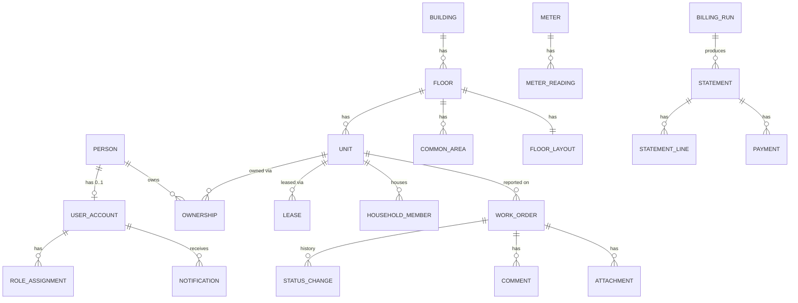

# Roles, permissions, scenarios, domain model, screens, seed data

## 1. Roles and personas

| Role | Persona | Main goals | Permitted data scope |
|---|---|---|---|
| Administrator | **Radu**, platform operator | Manage users, roles and building assignments; configure the SLA policy, categories and reference data; inspect the audit trail and background-job health. | Whole platform. |
| Building Manager | **Mihai**, responsible for two buildings | Keep units, residents and leases accurate; triage and assign maintenance work; run monthly billing; publish announcements. | Assigned buildings only. |
| Resident (Tenant or Owner) | **Ana**, tenant in unit **4B** | Report problems and monitor progress; submit meter readings; review charges; make simulated payments; read announcements. | Own unit(s) and own records. |
| Technician | **Ioana**, plumbing and heating | Work from an assigned queue; update progress; document completed work. | Assigned work orders and only the context needed to complete them. |

## 2. Identity and role-assignment rule
A single person may hold several roles (for example an owner who is also a Building Manager). The data model must keep a person's identity separate from role assignments, and role assignments must be scoped to specific buildings (not universally applicable).

## 3. Main screens by role (guideline, not prescribed architecture)
Teams decide screen names, layouts and navigation; related functions may be combined or split.

| Role | Expected principal screens and capabilities |
|---|---|
| Resident | Home (own unit, open requests, latest statement, announcements); Submit a request; My requests + request detail (timeline, comments, confirmation, reopening); Meter readings; Statements, statement details and simulated payment; Announcements; Notifications; Profile. |
| Technician | My queue (filters; due today / overdue); Work-order detail (quick status actions, internal notes, photos); Floor map (assigned work highlighted); Notifications. |
| Building Manager | Dashboard; Buildings, floors and 2D floor map; Unit detail; Persons, ownership and leases; Work orders (list, board, detail, triage, assignment); Meters and readings review; Tariffs and common expenses; Billing runs (preview, approval, issue); Statements and payments; Announcements; Audit trail for own buildings; CSV export. |
| Administrator | Platform dashboard; Users, roles and building assignments; Configuration (SLA policy, categories, utility types); Audit trail; Background-job health. |

## 4. Roles and permissions matrix
Definitions: **own** = records where the person is a party (owner, tenant, household member, or maintenance reporter). **Assigned** = work orders assigned to that Technician. Authorization tests SHOULD be generated from this matrix (BE-C11, SEC-03).

| Capability | Administrator | Building Manager | Resident | Technician |
|---|---|---|---|---|
| Users, roles and building assignments | Manage | Invite residents to own buildings | No access | No access |
| Buildings, floors, units and layouts | Manage | Edit own buildings | No access | No access |
| 2D floor map | All buildings | Own buildings, full detail | Own building, without other residents' personal data | Buildings containing assigned work |
| Persons, ownership and leases | Read | Manage within own buildings | Read own records | No access |
| Submit maintenance requests | Yes | Yes, on behalf of residents | Own unit and own building's common areas | No |
| Triage, assign or reject work orders | Yes | Own buildings | No | No |
| Start, hold or resolve work orders | No | No | No | Assigned work orders only |
| Resident-visible comments | Read | Read and write | Own requests | Assigned work orders |
| Internal work notes | Read | Read and write | Never | Assigned work orders |
| Confirm or reopen a resolution | No | No | Own requests | No |
| Meters and readings | Read | Manage within own buildings | Submit and read for own unit | No access |
| Tariffs, common expenses and billing runs | Read | Manage within own buildings | No access | No access |
| Statements and payments | Read | Manage within own buildings | Read own statements and use simulated payment | No access |
| Announcements | Manage across all buildings | Manage within own buildings | Read targeted announcements | Read targeted announcements |
| Notifications | Own notifications | Own notifications | Own notifications | Own notifications |
| Audit trail | All records | Records for own buildings | No access | No access |
| Dashboards | Platform dashboard | Building dashboard | Personal dashboard | Personal work queue |
| Configuration: SLA policy, categories, utility types | Manage | Read | No access | No access |

## 5. Signature scenarios
Both scenarios MUST work end-to-end on the **Release** environment, MUST be automated as **end-to-end tests**, and form the backbone of the final demo. Location: **Aurora Residence**.

### 5.1 Scenario A — "A leak in apartment 4B" (maintenance, M4)
**Primary path**
1. Ana (Resident) reports "Water leaking under the kitchen sink" for unit 4B: category Plumbing, priority High, one photo. The request appears immediately in her list.
2. The platform creates a work order in state **Submitted**, writes an audit entry, notifies Mihai (Building Manager).
3. Mihai opens the floor map for floor 4; unit 4B shows an open-issue marker. He triages the request, keeps priority High (due date = 24 hours after submission under the SLA policy) and assigns it to Ioana (Technician).
4. Ioana sets **In Progress**, adds the internal note "valve must be replaced", moves it to **On Hold** while waiting for a part, resumes, then **Resolves** it and uploads a completion photo.
5. Ana is notified of every status change, follows the status timeline and confirms the repair → **Closed** (or reopens within 7 days).

**Escalation path:** if the due date passes before the work is resolved, the SLA job escalates to Mihai.

**Audit and dashboard consequence:** Radu (Administrator) can reconstruct the full sequence from the audit trail; Mihai's dashboard reflects each change.

### 5.2 Scenario B — "Month-end at Aurora Residence" (billing, M5)
1. Before the billing period closes, residents without readings receive a reminder (SHOULD, M5-11).
2. Ana submits her cold-water and hot-water readings. A neighbour's reading is three times their usual consumption → flagged for review; Mihai confirms it with a note.
3. Mihai enters the month's common expenses (cleaning, elevator maintenance, common-area electricity) and runs a **billing preview**: each unit gets its consumption lines plus its allocated share of common expenses; totals reconcile **to the last cent**.
4. Mihai approves the billing run → statements are issued; residents are notified.
5. Ana makes a simulated **partial payment** → Partially Paid; pays the remainder later → **Paid**.
6. After the due date the overdue job marks unpaid statements **Overdue**; the manager dashboard shows outstanding balances and their age.

### 5.3 Mandatory seed/demo data for the scenarios (PX-08)
Seed MUST contain: Aurora Residence; unit 4B on floor 4; all four personas (Ana, Mihai, Ioana, Radu); documented demo accounts for each; enough supporting data for the jury to replay both scenarios.

## 6. Domain model at a glance
**Status:** a conceptual starting point, not a mandatory schema. The team designs the real model (DB-C02), MAY add/split/rename entities, but must cover every requirement in M1–M7. Cardinality: `1` exactly one; many; `0..1` optional.

| Module | Entities | Key relationships |
|---|---|---|
| M1 Identity | Person, UserAccount, RoleAssignment | A Person has 0..1 UserAccount; a UserAccount has many RoleAssignments; each RoleAssignment is scoped to a Building or a Unit. |
| M2 Buildings | Building, Floor, Unit, CommonArea, FloorLayout | Building has many Floors; Floor has many Units and many CommonAreas and one FloorLayout. Layout = geometry; live state comes from business data. |
| M3 Occupancy | Ownership, Lease, HouseholdMember | Ownership links Persons to Units over time (one or more owners per unit); a Lease links one Unit to one or more tenant Persons for a period; a renewal links to the previous lease; HouseholdMember links a Person to a Unit; together they give occupancy history. |
| M4 Maintenance | WorkOrder, StatusChange, Comment, Attachment, SlaPolicy | WorkOrder belongs to a Unit or a CommonArea; has exactly one reporter (Person) and 0..1 assigned Technician (Person); has many StatusChanges (history), Comments (resident-visible or internal) and Attachments; SLA config via SlaPolicy. |
| M5 Billing | Meter, MeterReading, Tariff, CommonExpense, BillingRun, Statement, StatementLine, Payment | Meter belongs to a Unit or a Building; Meter has many MeterReadings; Tariffs give effective prices; CommonExpense belongs to a building and billing period and is allocated across units; BillingRun produces one Statement per unit; Statement has many StatementLines and many Payments. |
| M6 Communication | Announcement, Notification | Announcement targets Buildings, Floors, Roles; Notification belongs to one UserAccount. |
| M7 Audit | AuditRecord | References the actor, the affected entity (type + ID) and the correlation ID. |

`[PACK NOTE]` The diagram is a simplified rendering of the table above, not a copy of the spec's figure.

## 7. Seed and demo data (PX-08 recap)
At least 2 buildings (with different floor layouts, M2-03), 60 units, 100 persons, 12 months of meter readings and of statements, 300 work orders across all states; reproducible (scripted), synthetic only; documented demo accounts for every role; Aurora Residence/4B and the four personas.

## 8. Design questions the spec suggests teams consider (not requirements)
- What must Ana understand within five seconds of signing in?
- How can the product make Mihai's Monday (14 new requests, 3 overdue) easier to handle?
- What does Ioana need on her phone while standing in front of a broken boiler?
- How could the system warn Radu that something is wrong before any user complains?

## 9. Ideas to make it your own (NOT requirements)
Examples from the spec: product name/logo/tone; a "My building today" summary for residents; a heat view on the floor map; printable QR codes per common area opening a pre-filled "report an issue" form; a technician "today" list ordered by floor with one-tap status changes; previous month's value and expected range on the meter-reading form; helpful empty states; keyboard shortcuts for managers triaging many requests.
Scoring rule: these earn no points by themselves; if they genuinely improve usability they may be reflected in Team Score categories A (product) and C (frontend/UX). They must never delay Core work.
