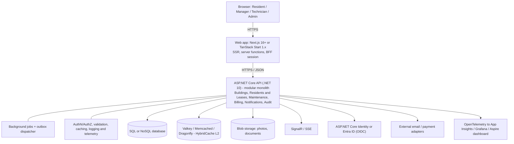

# Architecture requirements and technology/licensing policy

## 1. In short
- **Modular monolith** with clear boundaries; the **backend owns business rules**.
- The web application accesses data **only through the API** (including server-side frontend code).
- **Access tokens never live in browser storage.**
- Technology is limited to **Microsoft products, OSI-licensed open source, and two explicitly approved source-available exceptions** (MongoDB Community Server, Dragonfly).

## 2. Architecture requirements (ARC)

| ID | Level | Scope | Requirement | Evidence |
|---|---|---|---|---|
| ARC-01 | MUST | ALL | Use a modular monolith, or justify a different architecture in an ADR. Microservices give no scoring advantage. | ADR if different |
| ARC-02 | MUST | ALL | Clear separation of presentation, API/application use cases, domain, persistence, cross-cutting functions, and integrations/adapters. | Solution structure |
| ARC-03 | MUST | ALL | Backend/domain code owns business rules: state machines, billing, lease overlap, authorization relationships. | Code + tests |
| ARC-04 | MUST | ALL | The frontend/web app accesses persistent data only through the API, including server-side frontend code. | Code review |
| ARC-05 | MUST | ALL | Never put access tokens in `localStorage` or `sessionStorage`; use secure HttpOnly/SameSite cookies, directly or via a BFF. | Config + storage check |
| ARC-06 | MUST | ALL | Document C4 context/container/component architecture, deployment architecture, the data model and the Scenario A sequence. Diagrams SHOULD be maintained as code (for example Mermaid or PlantUML). | `docs/architecture/` |
| ARC-07 | MUST | ALL | Produce **at least 6 ADRs**: frontend framework, API style, database, auth, caching, hosting/deployment. **Every participant authors at least one.** | `docs/adr/` |
| ARC-08 | MUST | ALL | Document API conventions: naming, versions, pagination, filtering/sorting, errors, ETag/idempotency headers, dates, money. | `docs/architecture/` API conventions |
| ARC-09 | SHOULD | ALL | Decide and justify whether background jobs and real-time processing run in the API host or in a worker container. | ADR or architecture note |
| ARC-10 | MUST | ALL | Use Microsoft products, OSI-licensed open source, or the approved source-available exceptions only. Other commercial, source-available or company-size-threshold licences are prohibited. Check exact dependency versions and licences; list principal dependencies and licences in the README. | README dependency/licence list |

## 3. Reference architecture (example, not a requirement)



## 4. How a request flows — Scenario A
1. The resident page is server-rendered. Submission goes from the web app to `POST /api/v1/work-orders` using the user's session.
2. The API validates the request and checks Ana's object-level relationship with unit 4B. The work order, initial status history, audit record and outbox message are **committed in one transaction**.
3. A background dispatcher processes the outbox, creates notifications and emits the real-time event for the manager.
4. Building-related map/dashboard cache entries are invalidated.
5. Mihai's floor map updates unit 4B to show an open issue.
6. Triage/assignment sends `If-Match` with the work-order ETag. The state transition is validated; status, SLA due date, assignee, history, audit and outbox data are written atomically.
7. Technician updates follow the same pattern. Ana receives resident-visible updates; internal notes stay on manager/technician endpoints.
8. One distributed trace covers web app → API → database; the correlation ID propagates into logs.

## 5. API conventions (examples)
```
GET  /api/v1/buildings/{buildingId}/floors/{floorId}/map
GET  /api/v1/work-orders?status=Assigned&priority=High&sort=-dueAt&page=2&pageSize=25
POST /api/v1/work-orders/{id}/transitions        If-Match: "7"
     { "to": "InProgress", "reason": null }
POST /api/v1/statements/{id}/payments            Idempotency-Key: 6f1c2b7e-0d8a-4c1e-9a55-3f2f8a7c9e10
```
Errors use **RFC 9457 ProblemDetails**. The spec's example is an invalid work-order transition (Submitted → Resolved) returning **HTTP 409**:
```json
{
  "type": "https://errors.example.org/work-orders/invalid-transition",
  "title": "Invalid status transition",
  "status": 409,
  "detail": "A work order in state 'Submitted' cannot move to 'Resolved'.",
  "instance": "/api/v1/work-orders/8812/transitions",
  "traceId": "00-4bf92f3577b34da6a3ce929d0e0e4736-00f067aa0ba902b7-01"
}
```
The response carries a distributed trace identifier and no internal exception details (SEC-11).

## 6. Technology and licensing rules (ARC-10)
Matrix reflects licensing status as of **October 2026**. Exact package versions still need their licences checked.

### 6.1 Allowed options by need

| Need | Allowed options |
|---|---|
| Distributed cache, HybridCache L2 | **Valkey** (BSD-3 / Linux Foundation), **Memcached** (BSD), **Dragonfly** (approved exception) |
| Real-time backplane (BE-A04) | **Azure SignalR Service**, **Valkey**, **Dragonfly**. Memcached is unsuitable (no pub/sub). |
| Document DB / NoSQL | **MongoDB Community Server** (approved exception), **Azure Cosmos DB**, **DocumentDB** (MIT, MongoDB-compatible) |
| Infrastructure as Code | **Bicep** |
| Local containers | **Podman + Podman Desktop**, or **Rancher Desktop** |
| Load testing | **Azure Load Testing**, **k6**, **Apache JMeter** |
| Mapping / request dispatching | Plain C#, or **Mapperly** (generated mapping) |
| Test assertions | xUnit/NUnit/MSTest assertions, or **Shouldly** |
| Image processing (SEC-07) | **SkiaSharp** |
| PDF output (M7-07) | **Playwright print-to-PDF** or **PDFsharp** |
| Identity provider | **ASP.NET Core Identity**, **Microsoft Entra ID**, **Keycloak**, **OpenIddict** |
| UI components | **Fluent UI React**, **shadcn/ui** |
| Secret scanning | GitHub/Azure DevOps facilities where available; otherwise **Gitleaks** |
| Development email (M6-08) | **smtp4dev** or **Mailpit** |

Caching note: Valkey and Dragonfly work with the standard Redis-protocol .NET client. Memcached can integrate with HybridCache through an `IDistributedCache` implementation such as EnyimMemcachedCore. Record the decision in the caching ADR (ARC-07).

### 6.2 Approved source-available exceptions

| Product | Licence | Approved conditions |
|---|---|---|
| MongoDB Community Server | Server Side Public License (SSPL) | Self-hosted and unmodified, as the database for your own application; never offered as a service to others. |
| Dragonfly | Business Source License 1.1 | Self-hosted and unmodified, as the application cache; never offered to others as a data-store service. |

### 6.3 Not allowed (examples)

| Product | Reason / required alternative |
|---|---|
| Redis | Not used. Choose Valkey, Memcached or Dragonfly. |
| Terraform and OpenTofu | Project IaC is **Bicep**. (The spec notes Terraform 1.6+ uses the source-available Business Source License.) |
| Docker Desktop | Paid licensing in large organisations. Use Podman or Rancher Desktop. |
| MediatR 13+ / AutoMapper 15+ | Commercial licence or reciprocal RPL-1.5 terms. |
| FluentAssertions 8+ | Commercial use needs a paid licence. |
| ImageSharp / QuestPDF / Duende IdentityServer / NBomber | Free use limited by company size, revenue or qualifying use. |
| Commercial UI suites | Paid licences. |

### 6.4 Checking a package (AI-06)
GitHub Copilot may be used for a first look at a licence, but confirm from the package's own repository or site. Verify that the package exists, is the intended one (not a look-alike), is actively maintained and has a permitted licence. Take uncertain cases to the jury. Teams may use UI libraries, templates and starter kits if they are allowed under ARC-10 and declared in the README; the domain logic must be the team's own.

## 7. .NET 11 note
.NET 11 was expected in November 2026 as a Standard Term Support release. Teams may move to it only after general availability and with an ADR. **.NET 10 LTS remains the baseline.**
