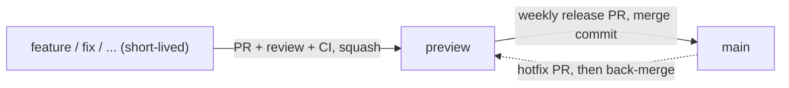

# Collaboration — Git workflow, releases, ways of working, planning

## 1. In short
- Work on **short-lived personal branches** and integrate into `preview` **every week**.
- From **Week 2**, promote `preview` → `main` through **one release PR every week**, then **tag** the release.
- Personal branch → `preview`: **squash merge**. `preview` → `main`: **merge commit only** (never squash or rebase).
- Rotate a **release captain**, share a **Definition of Done**, keep weekly **effort records**.

## 2. Git requirements (GIT)

| ID | Level | Scope | Requirement | Evidence |
|---|---|---|---|---|
| GIT-01 | MUST | ALL | One central **private** repository (GitHub or Azure DevOps/Azure Repos); never public. **Jury read access by end of Week 1.** | Repo settings and jury access |
| GIT-02 | MUST | ALL | A **monorepo** with the frontend/web app, API/backend, database scripts, infrastructure, tests and documentation. | Repository structure |
| GIT-03 | MUST | ALL | Every participant integrates into `preview` **at least once each week** (preferably more). Branch from current `preview`, keep in sync. Personal branches SHOULD last **no more than 3 working days**. No incomplete work on long-lived branches — use feature flags. | PR history showing weekly integrations |
| GIT-04 | MUST | ALL | From Week 2, create **one `preview` → `main` release PR every week**. | Weekly release PR history |
| GIT-05 | MUST | ALL | Personal branch → `preview`: **squash merge**. `preview` → `main`: **merge commit only**, not squash or rebase (preserves common history, avoids re-listing released changes in later release PRs). | Git history; repository merge settings |
| GIT-06 | MUST | ALL | Protect `preview` and `main` using GitHub rules/rulesets or Azure DevOps branch policies with the settings in §3. | Branch-policy/ruleset configuration |
| GIT-07 | MUST | ALL | **Conventional Commits** (`feat:`, `fix:`, `refactor:`, `test:`, `docs:`, `chore:`, `ci:`, `perf:`) including the work-item reference (`#123` on GitHub, `AB#123` in Azure Boards). | Commit history |
| GIT-08 | MUST | ALL | PRs use the prescribed PR template (`templates/pull-request-template.md`). Keep changes focused — SHOULD stay around or below **400 changed lines** (excluding generated files). UI changes include screenshots; PRs include test evidence and AI-assistance disclosure. | Completed PR template, screenshots, tests, AI disclosure |
| GIT-09 | MUST | ALL | Every participant reviews **at least one PR every week**, including outside their own track. Reviews meaningfully cover correctness, security, readability and tests. Review turnaround SHOULD be within one working day. | PR review history |
| GIT-10 | MUST | ALL | A **hotfix** starts from `main`, returns to `main` through a PR, and is followed immediately by a **`main` → `preview` back-merge**. | Hotfix PR + back-merge |

**Repository mapping:** The canonical normal PR template is [`../../.github/pull_request_template.md`](../../.github/pull_request_template.md); the weekly release template is [`../../.github/PULL_REQUEST_TEMPLATE/release.md`](../../.github/PULL_REQUEST_TEMPLATE/release.md).

## 3. Branch model and mandatory branch protection

`preview` = integration trunk (continuous small integrations). `main` = release line, must stay deployable.

| Branch | Purpose | Updated through |
|---|---|---|
| `main` | Stable release line | Weekly release PR from `preview`, plus urgent hotfix PRs |
| `preview` | Integration trunk | PRs from personal short-lived branches |
| `<type>/<alias>/<item>-<description>` | Individual development (example: `feature/alias/142-work-order-kanban`) | Owner works here; PR → `preview` |
| `hotfix/<item>-<description>` | Urgent release correction | Created from `main`; PR → `main`, then back-merge |

Allowed branch types: `feature`, `fix`, `refactor`, `test`, `docs`, `chore`, `spike`.

**GIT-06 protection settings**

| Setting | `preview` | `main` |
|---|---|---|
| PR required / no direct push | Yes | Yes |
| Minimum approvals | **1** | **1 for a team of 2; 2 for a team of 3–4** |
| Author can supply the required approval | No | No |
| CI/status checks required | Yes | Yes |
| All review conversations resolved | Yes | Yes |
| Linked work item | Yes | Yes, with all included items listed on the release PR |
| Force-push / delete protection | Yes | Yes |
| Dismiss approvals when new commits arrive | Yes | Yes |
| Merge method | Squash (except `main` back-merges) | Merge commit |
| Linear history | **No** | **No** (must not be enforced: release/back-merges need merge commits) |

## 4. Environments and change flow
- Normal change: branch → PR → CI → human review → squash into `preview` → publish Preview images → Preview smoke tests.
- Weekly promotion: release PR `preview` → `main` → CI/approvals → merge commit → SemVer tag → release notes → release images → Release environment (or locally runnable release) → smoke tests.

| Environment | Intent |
|---|---|
| Local | Development/debugging from any branch with the one-command stack |
| PR environment | Optional/Advanced (OPS-A02): per PR, destroyed after closure |
| Preview | Latest integration state from `preview` |
| Release | Versions promoted to `main` and tagged — used for weekly releases, the final demo and grading |

Hosting is optional unless OPS Advanced is in scope. If not hosted, published images must still let the pipeline smoke-test each version and let the jury start it locally with **one command**.

## 5. Weekly release ritual (from Week 2)
1. The week's **release captain** (rotating) opens a `preview` → `main` PR titled **`Release vX.Y.0 - Week N`** using the [release PR template](../../.github/PULL_REQUEST_TEMPLATE/release.md).
2. The PR records: highlights and known issues; included/linked work items; DB migrations and data changes; test and smoke-test evidence from Preview; rollback plan; progress against `docs/team/plan.md`.
3. GIT-06 approvals/policies pass; **merge with a merge commit**.
4. **Tag `main`** with Semantic Versioning (`0.x` during development; final submission `v1.0.0`; first release `v0.1.0` at end of Week 2).
5. Publish release notes (GitHub/Azure DevOps mechanism) and update `CHANGELOG.md`.
6. Pipeline produces release images, deploys to Release if hosted, smoke-tests, records the release.
7. If nothing is releasable that week, the captain records the reason in the weekly notes (the week does not simply disappear).

**Suggested weekly rhythm (example, not mandatory):** Monday plan + confirm captain · Mon–Thu small PRs to `preview` (review within a working day) · Thursday stabilise `preview`, clear failures, verify Preview · Friday release PR → `main`, tag/release notes, weekly 15-minute team sync.

**Weekly self-check (≈ 5 minutes, before opening the release PR)**
- [ ] `preview` CI is green and the Preview build actually runs.
- [ ] Every member merged ≥ 1 PR this week and reviewed ≥ 1 PR outside their own track.
- [ ] Board and project plan match reality.
- [ ] Everyone's effort log is current and everyone made their weekly AI Engineering Journal entry.
- [ ] No new unresolved Critical or High vulnerabilities.
- [ ] Once Scenarios A and B exist, both still pass end-to-end.

## 6. Ways of working (PRC)

| ID | Level | Scope | Requirement | Evidence |
|---|---|---|---|---|
| PRC-01 | MUST | ALL | Create the **Team Charter in Week 1**: members and package ownership, working agreements (availability/response expectations), communication channel, decision process, conflict resolution, release-captain rotation, Definition of Done. | Team Charter (template D.7) |
| PRC-02 | MUST | ALL | A backlog with an **epic per module**, stories with acceptance criteria and estimates, and weekly iteration planning. Given/When/Then SHOULD be used for acceptance criteria. Board status reflects reality. | Current GitHub Projects / Azure Boards board |
| PRC-03 | MUST | ALL | Meet as a team **weekly for at least 15 minutes**. Keep short notes in the repo: decisions, risks, blockers. | Weekly notes in the repository |
| PRC-04 | MUST | ALL | Use a **Definition of Done** (see §7). | PRs, CI, Preview verification, tests/docs/security evidence, closed items + hours |
| PRC-05 | MUST | ALL | A **Week-1 project plan** at `docs/team/plan.md` with milestones, build order and ownership; kept current; every weekly release PR reports progress against it. | `docs/team/plan.md` + progress sections in release PRs |
| PRC-06 | MUST | ALL | Each person records effort **every week and per work item**: date, item, engineering package, activity type, hours, evidence link (activity: design/code/test/review/docs/ops/meeting/learning). | Azure Boards Completed Work, GitHub Projects number field, or `docs/team/effort-log.csv` |
| PRC-07 | MUST | ALL | Each participant reaches **≥ 40 evidenced hours**, consistent with board/repository. Package-relevant learning may count, max **25%** of total logged hours. | Cross-checkable effort log |
| PRC-08 | MUST | ALL | Commit count and lines of code are **not** effort metrics and are not grading measures. | Effort shown through substantive evidence |

**Team implementation:** The selected GitHub-native effort mechanism is recorded in [`../team/decision-register.md`](../team/decision-register.md); the requirement row above retains all allowed evidence options.

## 7. Definition of Done (PRC-04, QA-09)
A work item is Done when: acceptance criteria are met **and checked on Preview** · code is reviewed and merged · CI is green · appropriate tests exist · documentation/ADRs are current · no new unresolved Critical/High vulnerabilities · accessibility checked for UI changes · logging/telemetry exists for new flows · the work item is closed and hours are recorded. Teams may add rules; put the full list in the Team Charter.

## 8. Planning your project (Section 12)
There are **no jury checkpoints**; the team sets and maintains its own milestones.

**Fixed points**

| When | Required outcome |
|---|---|
| Week 1 | Team Charter + project plan + repository; jury read access; team details sent to the jury |
| Every week from Week 2 | `preview` → `main` release PR and version tag |
| End of Week 12 | Final submission: `v1.0.0` on `main` + submission package |
| End of edition | Demo Day + technical interviews |

**Suggested milestones (recommended, not mandatory dates)**

| Week | Phase | Expected progress |
|---|---|---|
| 1 | Inception | Charter and package ownership; project plan; first backlog; repo and branch policies; basic CI; first ADR drafts; initial data model; AI instructions v1 |
| 2 | Walking skeleton | Sign-in + one page working web → API → DB; release `v0.1.0`; Compose setup; initial seed |
| 3–5 | Foundation | M1; M2 incl. first 2D map; M3; DB migration + seed in the pipeline; first E2E test; initial cached reads |
| 6–8 | Core workflows | M4 maintenance workflow; M5 utilities/billing; M6 announcements/notifications/jobs; M7 audit/dashboard/export; Scenarios A and B on Release |
| 9–10 | Depth and hardening | Advanced packages; threat model/scanning; performance evidence; accessibility pass; backup/restore exercise; ≈ `v0.9.0` release candidate |
| 11 | Stabilisation | Bug bash; finish docs/runbook; demo script/video; **recommended code freeze at end of week** |
| 12 | Final | Release `v1.0.0`; submission package; retrospective and individual reflections |

**Preferred starting path:** a thin Scenario A vertical slice — sign-in → floor map → submit maintenance request → triage → resolve — instead of many disconnected screens.
The jury grades the submitted `v1.0.0`; post-submission fixes are not graded and Demo Day should show the submitted build.

## 9. Board setup (PRC-02)
Top-level epics: **M1** Identity, roles and access · **M2** Buildings, floors, units and 2D map · **M3** Residents, occupancy and leases · **M4** Maintenance / work orders · **M5** Utilities, billing and payments · **M6** Announcements / notifications · **M7** Audit, dashboards and reporting. Decompose into stories (with acceptance criteria, preferably Given/When/Then, and estimates) and tasks; plan weekly iterations; add an effort-tracking field; link PRs and work items; reference requirement IDs (for example "Implements M4-03 and BE-C05").

## 10. What the Team Charter and project plan contain
**Team Charter (D.7):** team name · members + packages owned + usual availability · working agreements (availability, response times, review turnaround) · communication channel + weekly sync slot · decision-making and conflict resolution · release-captain rotation · Definition of Done (PRC-04 plus team additions). A 3-person team also records its two chosen Advanced packages. Canonical document: [`../team/charter.md`](../team/charter.md).
**Project plan (D.8):** team name + last-updated date · milestones table (target week, milestone, modules/packages, owner, status) · build order and dependencies · risks and mitigations · changes to the plan (date, what, why). Canonical document: [`../team/plan.md`](../team/plan.md).
